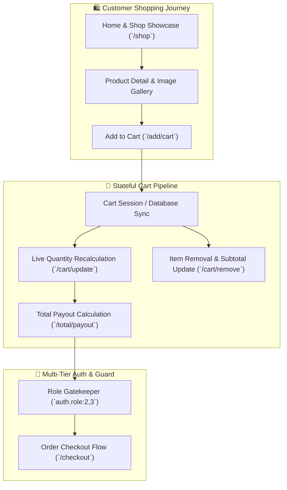

# Multi-Tier E-Commerce Web Platform & Shopping Cart Engine

[](https://laravel.com)
[](https://www.php.net)
[](https://tailwindcss.com)
[](https://www.mysql.com)
[]()

A clean, full-stack **E-Commerce Storefront, Product Catalog & Cart Management Engine** built with **Laravel 10** and **PHP 8.1+**. Features hierarchical product category navigation, a stateful shopping cart pipeline with asynchronous quantity adjustment and line-item recalculation, multi-tier user role authentication (`auth.role`), and dedicated merchant administrative management.

---

## 🏛️ Shopping Cart & Order Lifecycle



---

## 🌟 Core System Modules

### 1. 🛍️ Product Catalog & Taxonomy Navigation
- **Hierarchical Classification:** Relational database structuring (`Category` has many `SubCategory`, which has many `Product`).
- **Interactive Shop Directory:** Filterable product listings with real-time stock availability, featured tags, and product detail viewports.

### 2. 🛒 High-Speed Shopping Cart Engine
- **Transactional Cart Operations:** Powered by `CartController` handling instant cart addition, quantity updates, line-item purging, and dynamic order subtotal/tax calculations.
- **Persistent Cart State:** Maintains customer shopping carts across sessions.

### 3. 🔐 Multi-Tier Role-Based Authentication
- **Segmented Route Protection:** Middleware (`auth.role`) guarding customer checkout and administrative control centers.
- **Dedicated Portals:**
  - **Customer Portal:** Registration (`/user/register`), secure login (`/user/login`), personal order tracking.
  - **Merchant Admin:** Staff onboarding (`/admin/register`), administrative session login (`/admin/login`), and product catalog CRUD.

---

## 🛠️ Technology Stack

| Layer | Technologies |
|---|---|
| **Core Framework** | Laravel 10.x, PHP 8.1 / 8.2 |
| **Frontend UI** | Blade Templating Engine, Tailwind CSS, JavaScript |
| **Authentication** | Multi-Guard Authentication with Role-Based Middleware (`auth.role`) |
| **Database** | MySQL 8.0 (Relational schema with foreign key cascades) |
| **Asset Pipeline** | Vite |

---

## 📂 Domain Layout

```
e-commerce-website/
├── app/
│   ├── Http/
│   │   ├── Controllers/
│   │   │   ├── HomeController.php             # Public showcase & catalog
│   │   │   ├── CartController.php             # Stateful cart operations & payout
│   │   │   ├── UserLoginController.php        # Customer authentication
│   │   │   ├── UserRegisterController.php     # Customer registration
│   │   │   └── Admin/                         # Admin authentication & catalog CRUD
│   │   └── Middleware/
│   │       └── RoleMiddleware.php             # Multi-tier role authorization
│   └── Models/
│       ├── Cart.php                           # Active customer cart items
│       ├── Category.php                       # Primary parent categories
│       ├── SubCategory.php                    # Nested sub-classifications
│       ├── Product.php                        # Master product model
│       └── User.php                           # Customer & merchant accounts
├── routes/
│   └── web.php                                # Route declarations
└── composer.json
```

---

## ⚙️ Local Development & Quick Start

### Prerequisites
- **PHP:** `>= 8.1` (Extensions: `pdo_mysql`, `mbstring`, `openssl`, `curl`)
- **Composer:** `>= 2.2`
- **Node.js & NPM:** `Node 18+` / `NPM 9+`
- **Database:** MySQL 8.0+

### Setup Instructions

```bash
# 1. Clone repository
git clone https://github.com/alramim07/e-commerce-website.git
cd e-commerce-website

# 2. Install PHP and NPM dependencies
composer install
npm install

# 3. Environment configuration
cp .env.example .env
php artisan key:generate

# 4. Database configuration in .env
# DB_CONNECTION=mysql
# DB_HOST=127.0.0.1
# DB_PORT=3306
# DB_DATABASE=ecommerce_db
# DB_USERNAME=root
# DB_PASSWORD=

# 5. Run database migrations & seed demo products
php artisan migrate --seed

# 6. Build assets & start server
npm run build
php artisan serve
```

Access the storefront at: **`http://127.0.0.1:8000`**

---

## 📄 License
This project is open-source software licensed under the [MIT License](LICENSE).
